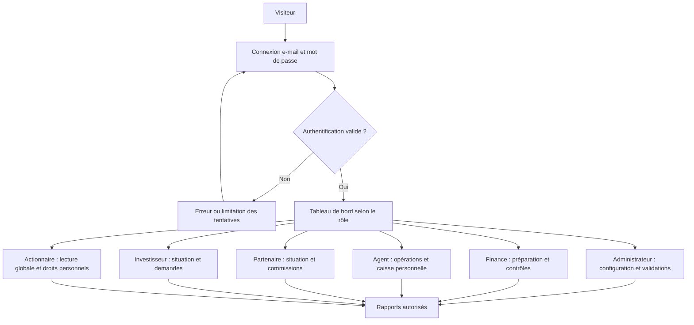
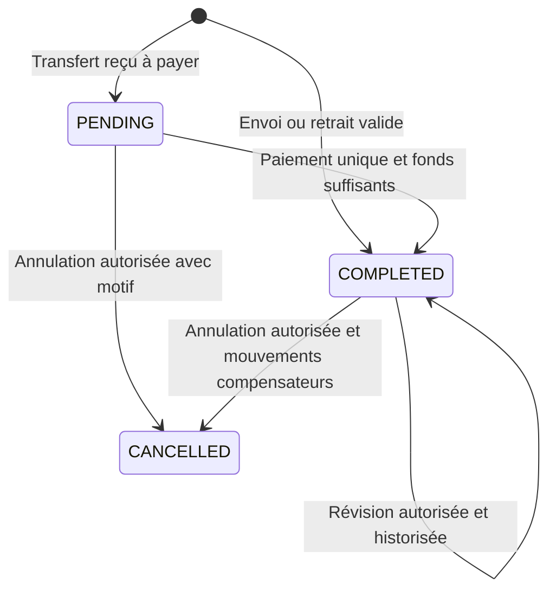
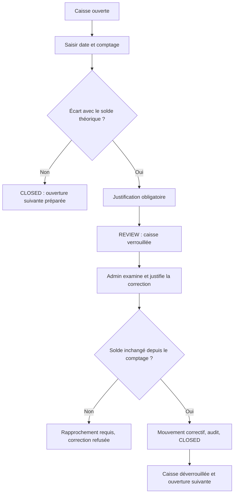
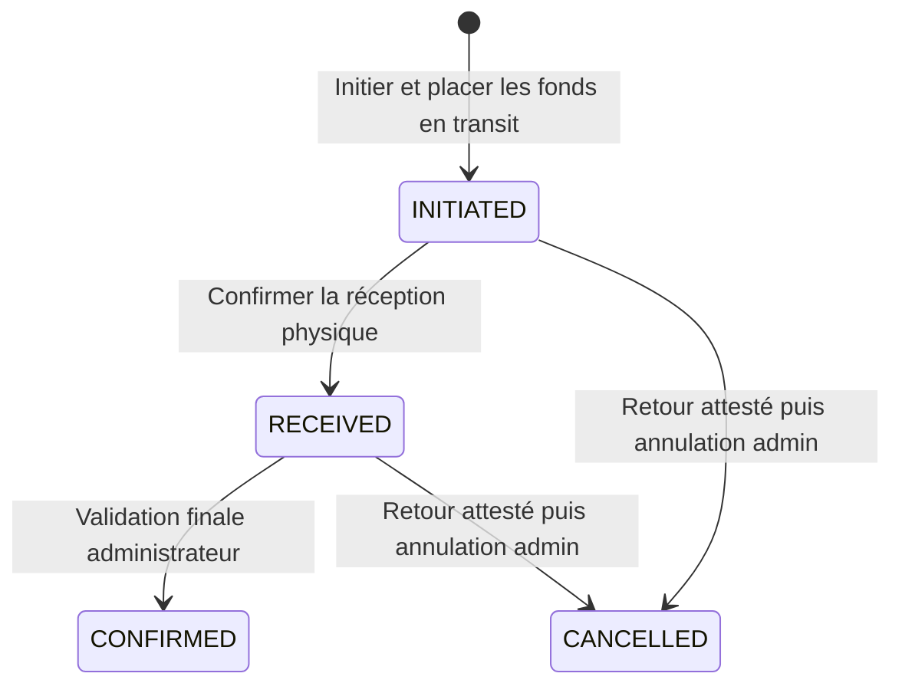
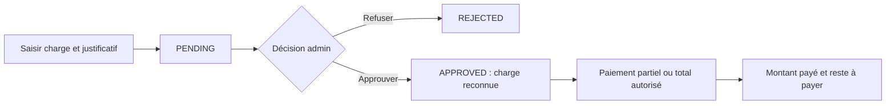

# FINCORYA — App Flow

**Version 1.0 · 9 octobre 2026 · Parcours existants et cible de stabilisation**

## 1. Principes de lecture

Les URL et statuts ci-dessous proviennent du code actuel. Une flèche représente une action utilisateur ou un passage d'état ; elle ne représente pas nécessairement une nouvelle page. Les améliorations non implémentées sont explicitement marquées **cible**. Le MFA est volontairement désactivé pour l'accès à l'application.

La caisse physique, un transfert interne, une opération client et un résultat comptable sont quatre objets différents : leurs statuts et leurs validations ne doivent pas être confondus.

## 2. Vue globale

La session ne confère pas tous les droits : les services appliquent leurs propres contrôles de rôle et de propriété. La console `/admin/` possède aussi ses permissions Django. Les routes MFA héritées restent présentes mais ne font pas partie du chemin nominal de connexion.

## 3. Navigation et responsabilités

| Surface | URL réelle | Rôles / usage |
|---|---|---|
| Connexion | `/auth/login/` | Public |
| Activation par invitation | `/auth/activer/<user_id>/<token>/` | Titulaire du lien valide |
| Tableau de bord | `/` | Utilisateur connecté, contenu adapté |
| Profil / mot de passe | `/auth/profil/`, `/auth/profil/mot-de-passe/` | Utilisateur connecté |
| Gestion des utilisateurs | `/auth/utilisateurs/` | Admin |
| Opérations | `/operations/`, `/operations/nouvelle/` | Saisie admin/agent ; consultation selon périmètre |
| Services sélectionnables | `/operations/services/` | Administration du catalogue |
| Caisses | `/caisses/`, `/caisses/<account_id>/` | Admin/finance en consultation globale ; agent sur ses caisses |
| Finance | `/finance/`, `/finance/registre/<section>/` | Admin/finance ; exception du registre des transferts pour agents |
| Charges | `/charges/`, `/charges/nouvelle/` | Saisie/lecture selon rôle, décision admin |
| Situation d'une partie | `/finance/parties/<pk>/` | Consultation admin/finance |
| Espace personnel économique | `/finance/mon-espace/` | Partie liée à l'utilisateur |
| Centre de rapports | `/rapports/centre/` | Catalogue et périmètre selon rôle |
| Consolidé mensuel | `/rapports/mensuel/` | Admin |
| Situation déclarée de septembre | `/rapports/situation-septembre-2026/` | Admin, déclaration requise |
| Administration technique | `/admin/` | Personnel autorisé selon permissions Django |

L'inventaire exhaustif des **69 routes nommées hors admin** est fourni dans [evidence.json](evidence.json). Les valeurs autorisées de `section`, `kind` et `action` doivent rester celles des vues ; une URL paramétrée ne promet pas une action arbitraire.

## 4. FLOW-01 — Création de compte et accès

**Acteurs :** admin puis utilisateur. **Prérequis :** admin actif, rôle choisi, adresse unique.

1. L'admin ouvre Utilisateurs → Créer → choisit le rôle.
2. Il saisit identité et identifiants ; le formulaire actuel comporte un mot de passe. La création ne vaut pas création d'un apport ni d'une garantie.
3. L'application crée le compte, journalise l'action et met en file l'e-mail d'invitation après commit.
4. Le titulaire ouvre le lien d'activation à durée limitée et définit son mot de passe.
5. La connexion réussie conduit directement au tableau de bord, sans étape TOTP.
6. Le renvoi d'invitation invalide le lien précédent. La désactivation d'un compte est réservée à l'admin avec restrictions sur son propre compte et le superutilisateur.

**Erreurs :** e-mail déjà utilisé, lien expiré/invalide, mots de passe non conformes, limitation de tentatives. **Cible :** aligner le formulaire de changement de mot de passe sur le même parcours sans MFA (AUD-02). La désactivation MFA ne supprime ni mot de passe, ni session, ni autorisations.

## 5. FLOW-02 — Mise en service financière

**Acteurs :** admin ; finance pour certaines préparations. **Statut :** capacités présentes, activation réelle non attestée.

Une migration technique de base de données ne crée pas la reprise comptable. L'ouverture d'une caisse ne crée pas d'argent. Un apport déjà compris dans la reprise ne doit pas être encaissé une deuxième fois. Le paramétrage du moteur et son activation doivent suivre le protocole du TRD, pas une simple modification de variable.

## 6. FLOW-03 — Opération client

**Acteurs :** agent sur sa caisse ou admin. **Entrées :** type, caisse/devise, service, client, montant, commission explicite même nulle, mode de frais, frais fournisseur éventuels, attribution partenaire et note.

1. Ouvrir Nouvelle opération.
2. Renseigner les champs et consulter l'aperçu ; aucune écriture n'est créée par l'aperçu.
3. Valider ; le serveur contrôle caisse, montant, frais, taux, solde et garantie si partenaire.
4. Recevoir la référence et l'état réellement enregistré.
5. Consulter le détail ; seules les actions autorisées et compatibles avec l'état peuvent réussir.

**Impact caisse, après normalisation du montant saisi :**

| Cas | Impact observé dans les services |
|---|---|
| Envoi | Entrée du principal et de la commission, diminuée du frais fournisseur |
| Réception enregistrée en attente | Aucun décaissement immédiat |
| Paiement d'un reçu | Sortie du principal moins commission, plus frais fournisseur |
| Retrait, frais ajoutés | Sortie du montant principal plus frais fournisseur |
| Retrait, frais déduits | Sortie du principal moins commission, plus frais fournisseur |

Le **montant principal stocké** peut différer du montant entré selon le mode de frais ; l'aperçu doit expliquer les montants remis/reçus. Une correction n'est pas une édition libre de l'historique : les règles de clôture et d'intégrité s'appliquent. La purge administrative d'une opération annulée existe mais refuse les dépendances comptables/historiques contrôlées ; ce n'est pas le parcours normal de correction.

**Échecs :** caisse inactive/verrouillée, fonds insuffisants, frais invalides, reçu déjà payé, période fermée, plafond dépassé. **Sortie attendue :** résultat unique, référence stable, audit et mouvement traçables. [Services opérations](../../apps/operations/services.py).

## 7. FLOW-04 — Caisse et clôture quotidienne

**Acteurs :** agent propriétaire ou admin pour le comptage ; admin seul pour la correction d'écart. Le code autorise l'agent à clôturer sa caisse ; les textes historiques qui l'interdisent sont obsolètes ou à arbitrer.

Le comptage divergent ne modifie plus automatiquement le solde. Le comptage initial, l'écart et la justification restent visibles. Le code actuel n'offre pas une transition distincte « rejeter le comptage » : **cible proposée**, permettre une nouvelle saisie auditée si la déclaration était erronée, sans effacer la première.

La remise physique à l'admin est un autre parcours : déclaration → attente → confirmation par une autre personne autorisée → mouvement. Elle ne remplace pas le transfert interne du grand livre.

## 8. FLOW-05 — Transfert interne

**Acteurs :** admin/finance, agent limité à sa caisse. **Prérequis :** moteur actif, source et destination compatibles, solde source suffisant.

À l'initiation, la source diminue et le transit augmente ; les frais éventuels sont séparés. À `RECEIVED`, les fonds ne sont pas encore disponibles à destination. À `CONFIRMED`, le transit est soldé et la destination augmente. Le retour effectif est attesté dans des champs dédiés ; ce n'est pas un cinquième statut. L'annulation ne doit pas prétendre qu'un cash a été rendu sans attestation.

**Invariant :** source + transit + destination constant hors frais. **Échecs :** double confirmation, destinataire non autorisé, retour non documenté, solde insuffisant. Voir [funds.py](../../apps/finance/funds.py).

## 9. FLOW-06 — Apports, partenaires et investisseurs

| Parcours | Étapes | Résultat |
|---|---|---|
| Nouvel apport | Admin → origine/partie → montant/devise/date → destination → justificatif/référence → validation | Encaissement unique et compte de contrepartie |
| Apport déjà repris | Même identification → cocher reprise → rapprochement justifié | Reclassement ; pas de nouveau cash |
| Reçu historique | Choisir reçu et apport compatibles → lien explicite | Aucune nouvelle écriture de réception |
| Partenaire | Créer partie → lier utilisateur → garantie financée → plafond explicite → règle de commission datée | Opérations attribuables dans les limites |
| Choix de commissions | Partenaire → Mon espace → conserver les commissions ou conversion automatique | Choix daté, applicable selon sa date d'effet |
| Investisseur | Créer partie/apport → règle de rémunération fixe → conditions contractuelles | Acquisition à la clôture selon règles, paiement distinct |

Le plafond partenaire est **par opération**, limité à 2 000 USD équivalents dans le code. La garantie doit être positive ; une opération peut excéder le montant de la garantie dans la limite du plafond. Le défaut actuel de part partenaire est 60 %, sans réécrire les taux déjà figés. Ces règles sont documentées comme implémentées, pas comme une nouvelle approbation métier.

## 10. FLOW-07 — Charges et règlements

`APPROVED` n'est pas synonyme de « payée ». Les paiements sont des objets distincts ; ils diminuent la dette et la trésorerie sans reconnaître une deuxième charge. Les salaires et rémunérations investisseurs doivent conserver cette séparation. Le contrôle de clôture signale les charges encore en attente.

## 11. FLOW-08 — Clôture de période et distribution

**Acteurs :** finance prépare ; admin clôture et approuve.

1. Ouvrir la période, compléter les comptages et résoudre les anomalies.
2. Confirmer l'attribution des commissions, les charges en attente et les brouillons du journal.
3. L'admin lance la clôture après la fin de période et après la bascule.
4. Pour un mois, le moteur acquiert les rémunérations applicables et fige le résultat et le plan de distribution.
5. Le statut passe de `OPEN` à `LOCKED` ; les écritures antidatées dans la période sont refusées, sous l'exception encadrée des acquisitions mensuelles lors de la clôture.
6. Finance/admin propose une enveloppe distribuable ; l'admin approuve.
7. L'admin paie ou exécute une demande de retrait/réinvestissement dans la limite des droits disponibles.

La nouvelle politique doit actuellement sélectionner **exactement quatre actionnaires à 25 %**. Les anciens modes restent représentables pour lire l'historique. Trésorerie disponible et bénéfice distribuable sont deux indicateurs différents ; un résultat positif n'autorise pas un décaissement sans cash.

## 12. FLOW-09 — Demandes des parties prenantes

| Rôle | Demandes implémentées |
|---|---|
| Actionnaire | Réinvestir un bénéfice, retirer un bénéfice |
| Investisseur | Augmenter ou retirer l'investissement |
| Partenaire | Augmenter la garantie, convertir les commissions en garantie |

Cycle : **SUBMITTED → APPROVED ou REJECTED → EXECUTED** (seule une demande approuvée s'exécute). Un commentaire de décision et les informations de règlement requises accompagnent le traitement. La soumission n'est pas une écriture de cash ; l'exécution constitue l'acte financier. Le lien entre utilisateur et partie est obligatoire, et un utilisateur ne peut agir pour une autre partie.

## 13. FLOW-10 — Rapports

1. Choisir un type autorisé, une période et des filtres.
2. Le serveur applique le périmètre utilisateur indépendamment des paramètres du navigateur.
3. Afficher le rapport ou demander un format téléchargeable autorisé.
4. L'export conserve son état, ses filtres et son snapshot ; le téléchargement passe par une vue protégée.
5. En cas d'échec, conserver une indication exploitable et permettre une nouvelle tentative adaptée.

| Rôle | Catalogue / limite notable |
|---|---|
| Admin | Ensemble des rapports et consolidé mensuel |
| Finance | Activité, trésorerie, commissions, charges, résultat, contrôle ; exports hebdomadaires selon les règles de génération |
| Agent | Activité personnelle, journée passée ou en cours |
| Actionnaire lié | Situation personnelle, activité globale et résultat en consultation |
| Partenaire / investisseur lié | Situation propre |

Les téléchargements sont configurables par rôle, avec admin/finance/agent par défaut. Les critères de génération restent applicables en plus de ce paramètre. **Cible :** le rapport absent de septembre montre un état vide et un chemin de retour, puis le choix de période remplace la navigation figée.

## 14. États transversaux à garantir

| État | Réponse utilisateur attendue |
|---|---|
| Liste vide | Expliquer l'absence ; action de création seulement pour le rôle autorisé |
| Envoi de formulaire | Indiquer le traitement ; conserver l'idempotence côté serveur |
| Validation métier refusée | Motif précis proche du champ ou résumé, valeurs conservées |
| Accès non autorisé | Refus serveur ; ne pas exposer les données dans le HTML |
| Session expirée | Reconnexion, aucune écriture partielle |
| Double clic / retry | Un résultat métier unique ou refus explicite, jamais double paiement |
| Caisse/période verrouillée | État visible et explication du prochain acteur requis |
| Export ou e-mail échoué | Statut vérifiable ; ne pas présenter une livraison comme reçue |

Ces états sont la cible de recette commune du [PRD](PRD.md) et du [design system](DESIGN-SYSTEM.md). Ils ne sont pas tous attestés visuellement dans chaque écran actuel.
