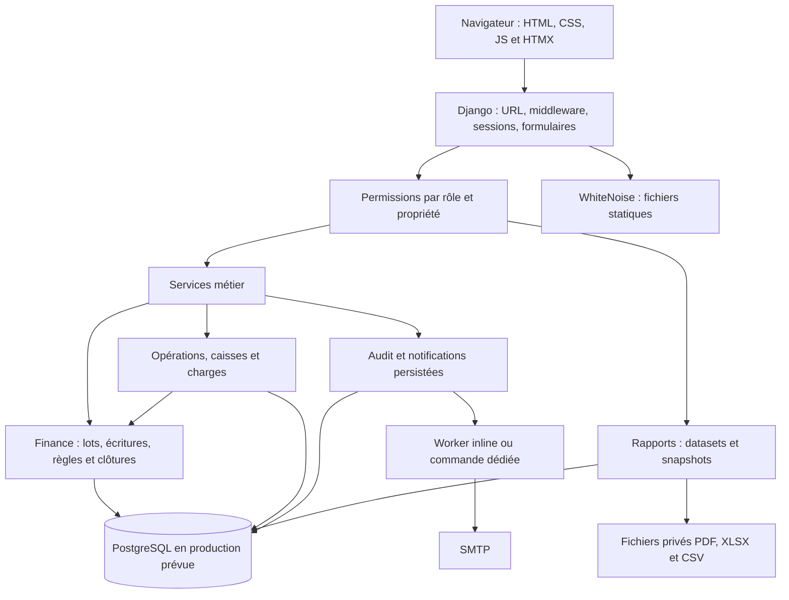
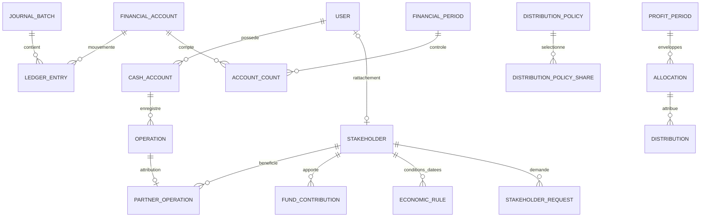

# FINCORYA — Technical Requirements Document

**Version 1.0 · 9 octobre 2026 · Architecture observée et exigences de stabilisation**

## 1. Objet et statut

Ce TRD décrit les contrats techniques qui doivent soutenir le [PRD](PRD.md). Il sépare la structure implémentée des corrections proposées. Les fichiers métier ne sont pas modifiés par ce dossier. La décision de connexion sans MFA est une contrainte produit confirmée.

## 2. Architecture observée

Monolithe Django modulaire, rendu serveur ; pas de SPA ni d'API REST publique établie dans les routes inspectées. HTMX améliore les interactions existantes, sans remplacer les vérifications serveur.

| Composant | Déclaration dans le dépôt / état observé |
|---|---|
| Python | 3.11.9 dans Render ; audit exécuté sous 3.14.3 |
| Django | 5.2.17 |
| Base production prévue | PostgreSQL via psycopg 3.3.5 ; SQLite de développement/repli |
| Serveur | Gunicorn 23.0.0, trois workers dans le manifeste |
| Statique | WhiteNoise 6.12.0, CSS propres, polices locales et distantes |
| Interactions | django-htmx 1.29.0, JavaScript local |
| Exports | ReportLab, svglib, openpyxl, Pillow |
| Authentification | User personnalisé par e-mail, sessions Django ; django-otp résiduel |
| Notifications | Modèles persistés, commande worker, thread inline optionnel |

Les versions sont celles des fichiers inspectés, pas une recommandation de mise à jour ni une vérification externe de vulnérabilités.

## 3. Modules et responsabilités

| Module | Responsabilité | Point d'entrée principal |
|---|---|---|
| accounts | Identité, rôle, profil, activation, permissions | `views.py`, `management_views.py`, `permissions.py` |
| pricing | Devises, taux, tarification historique | `services.py`, `models.py` |
| operations | Envoi/reçu/retrait, idempotence, correction | `services.py` |
| cash | Caisses, mouvements, allocations, remises, clôtures | `services.py` |
| finance | Grand livre, reprise, événements, fonds, résultat | `services.py`, `events.py`, `funds.py`, `closing.py` |
| expenses | Charges, justificatifs et décisions | `services.py`, paiements via finance |
| stakeholders | Parties, investissements historiques, attribution | `models.py`, `services.py` |
| profits | Historique des périodes et distributions | Modèles ; anciens calculs désormais refusés |
| reports | Exports privés, consolidé, déclaration mensuelle | `services.py`, `month_end.py` |
| notifications | File, délivrance, rappels | `senders.py`, `background.py`, commandes |
| audit | Journal des actes et contexte de requête | `services.py` |
| contracts | Contrats et versions documentaires | Modèles ; parcours autonome non établi |

## 4. Modèle de données logique

Diagramme logique partiel : il ne remplace pas les contraintes du schéma. En particulier, les comptes financiers peuvent être liés aux anciennes caisses, et les paiements ainsi que les transferts portent des références aux lots comptables. Le champ `Stakeholder.owner` est optionnel et contraint à un rattachement unique lorsqu'il est renseigné.

| Agrégat | Identité / invariant important |
|---|---|
| `Operation` / `OperationRequest` | Référence UUID ; requête idempotente ; états PENDING/COMPLETED/CANCELLED |
| `CashMovement`, `OperationRevision`, `AuditEvent` | Historique protégé au niveau applicatif ; ne pas confondre avec protection contre un administrateur SQL |
| `JournalBatch` / `LedgerEntry` | Clé d'idempotence et empreinte du contenu ; écritures équilibrées par devise |
| `FinancialAccount` | Nature/type/devise ; solde cache recalculable depuis les écritures |
| `FinancialPeriod` / `AccountCount` | Période ouverte/verrouillée, comptage théorique/déclaré |
| `FundContribution` | Origine, réception, compte, référence, reprise éventuelle et reçu historique lié |
| `InternalTransfer` | Source, destination, transit, réception, confirmation/retour, lots associés |
| `EconomicRule`, `DistributionPolicy` | Date d'effet ; règle figée dans les résultats et attributions concernés |
| `RemunerationTerms` | Dates contractuelles, mois partiel et déficitaire |
| `ReportExport` | UUID, auteur, format, filtres, snapshot, état et fichier privé |

Les montants utilisent `Decimal` et des champs décimaux ; les taux peuvent conserver plus de précision que les montants. Les arrondis par opération précèdent l'addition des parts partenaires. La convention globale d'arrondi doit être rendue explicite dans une future normalisation : ne pas remplacer silencieusement les `quantize` historiques par une autre règle.

## 5. Contrats techniques

### TRD-01 — Autorisations

Appliquer les capacités de `accounts.permissions` dans les vues **et** dans les services sensibles. Admin : préparer/approuver/administrer ; finance : préparer et consulter ; agent : caisses propres ; parties : situation propre ; actionnaire : lecture globale explicitement prévue. Les exceptions de parcours doivent être explicites, notamment le transfert interne des agents et l'ouverture d'une caisse vide par finance.

**Recette :** accès croisés par identifiant/UUID refusés, filtres client incapables d'élargir le périmètre, téléchargements soumis au rôle et au propriétaire/périmètre de l'export. La gestion des permissions Django admin reste distincte des seules capacités métier.

### TRD-02 — Authentification sans MFA

**État :** `mfa_required` est une garde de connexion ; login direct. **Cible :** renommer/documenter la garde de manière fidèle, autoriser la configuration production sans MFA, retirer l'obligation du champ OTP du changement de mot de passe, adapter les routes/écrans résiduels et les tests.

Conserver CSRF, session, cookies de production, limitation des tentatives, validation de mot de passe et contrôle du compte actif. Ne jamais traiter `LOCAL_AUTH_BYPASS` comme une alternative de production. Le bypass est un mécanisme local distinct de la désactivation MFA.

### TRD-03 — Transactions et idempotence

`ledger_atomic` ouvre une transaction et verrouille la ligne singleton `LedgerMutex(pk=1)`. Les services verrouillent également les objets nécessaires. Ce choix sérialise largement les actes financiers ; il privilégie l'intégrité au débit.

`prepare_batch` calcule une empreinte du contenu. Une même clé et un même contenu retrouvent le lot ; une même clé avec un autre contenu est refusée. La publication exige au moins deux lignes, des comptes actifs et l'équilibre par devise. La contre-passation crée de nouvelles écritures et conserve l'original.

**Cible de recette :** retries sur opérations, apports, transferts, paiements et demandes ; interruption entre étapes avec rollback ; concurrence sous PostgreSQL. Ne pas déduire les mêmes garanties de SQLite.

### TRD-04 — Source des soldes et bascule

En mode nouveau moteur, le grand livre est la source comptable et les soldes historiques sont des projections à rapprocher. `FINANCE_LEDGER_ENABLED` et une bascule approuvée conditionnent certains événements/workflows. En mode historique, les comportements ne sont pas identiques ; l'ancien calcul de bénéfice est retiré dans l'état de travail actuel.

**Procédure cible :** sauvegarder → suspendre les saisies → fixer un instant de bascule avec fuseau → simuler → résoudre les anomalies → vérifier l'empreinte → approuver/appliquer → comparer compte par compte → activer le mode nominal → réaliser une opération témoin contrôlée en recette. Ni le présent dossier ni son script de preuves n'effectuent cette procédure.

### TRD-05 — Dates et périodes

Stocker les instants avec fuseau et utiliser les bornes métier `[début, fin exclusive)` pour les événements horodatés. Les dépenses utilisent une date métier. `BUSINESS_TIME_ZONE` vaut Europe/Istanbul par défaut ; `TIME_ZONE` vaut UTC. Début de semaine configurable, lundi par défaut.

**Cible :** centraliser la notion de « aujourd'hui métier » pour l'accès agent aux rapports ; tester les événements autour de minuit, le passage d'année et les périodes personnalisées. Un rapport clôturé doit préciser son périmètre exact ; une clôture hebdomadaire ne remplace pas la clôture comptable mensuelle.

### TRD-06 — Règles de résultat

`partner_commissions` somme les parts arrondies par opération avec le taux figé. `compute_result` isole les différences de change du distribuable. `close_period` exige fin de période, bascule, absence de contrôles bloquants et crée des snapshots mensuels. Les rémunérations sont acquises une seule fois par clé investisseur/mois selon les conditions applicables.

La nouvelle politique de distribution est quatre bénéficiaires à 25 %. Conserver les anciennes politiques et snapshots sans réécriture. La correction d'une période verrouillée suit une procédure distincte ; ne jamais proposer un recalcul automatique de l'historique.

### TRD-07 — Charges et règlements

La décision admin reconnaît la charge ; le paiement règle une dette existante. Un paiement partiel laisse un reste dû. Prévenir la double acquisition d'une rémunération et les paiements concurrents excessifs. Les contrôles de la caisse physique doivent rester cohérents avec les écritures de paiement.

### TRD-08 — Rapports et exports

Trois pipelines sont présents : `finance.reporting.build_report`, `reports.services.monthly_financial_snapshot`, `reports.month_end.build_month_end_statement`. Les formats d'un pipeline utilisent ses données/snapshots, mais il serait incorrect d'affirmer que tous les écrans de l'application utilisent déjà une unique fonction.

**Cible :** documenter la source de chaque indicateur ; partager les agrégats équivalents ; préserver la déclaration humaine et sa comparaison ; rendre la période paramétrable ; tester écran/PDF/XLSX/CSV. Les exports doivent porter période, fuseau, filtres, devise, auteur, statut et référence. L'échec de construction doit marquer l'export FAILED et ne pas proposer un fichier incomplet. Rétention paramétrée à 365 jours par défaut, politique métier à confirmer.

### TRD-09 — Notifications

Persister les notifications et livrer après commit pour les événements concernés. Les notifications ne valident pas une écriture financière. Le worker inline est une option d'exploitation présente ; son démarrage depuis `AppConfig.ready` doit être encadré hors processus web. Les protections de déduplication doivent être vérifiées sous concurrence réelle.

**Cible :** métriques de taille/ancienneté de file, erreurs et tentatives ; journaliser les exceptions absorbées aux frontières métier ; confirmer les e-mails depuis un environnement de recette autorisé. Aucun e-mail n'est envoyé par cet audit.

### TRD-10 — Fichiers et frontend

Les fichiers privés passent par les vues protégées ; conserver une séparation entre `STATIC_ROOT` et `MEDIA_ROOT`. Les justificatifs, avatars et exports ont des exigences différentes de validation et d'accès. La présence d'un chemin `private/` n'est pas à elle seule une protection HTTP.

Le frontend utilise sept feuilles CSS globales dans un ordre fixé par `base.html`. `interface.css` contient les principaux tokens de marque et surcharge les couches précédentes. Le [design system](DESIGN-SYSTEM.md) fournit un catalogue extrait/proposé, sans l'injecter automatiquement dans l'application.

## 6. Interfaces métier principales

| Entrée de service | Données structurantes | Préconditions | Sortie/effet |
|---|---|---|---|
| `create_sent_transfer` / `create_withdrawal` | Acteur, caisse, montant, frais, clé | Droit caisse, paramètres valides, fonds si sortie | Opération + mouvement + événement comptable si moteur actif |
| `pay_received_transfer` | Opération, acteur | PENDING, caisse accessible et solvable | Paiement unique, COMPLETED |
| `record_contribution` | Partie, origine, devise, date, montant, compte, clé | Admin, moteur/bascule, cohérence reprise | Apport et lot ; refus de replay contradictoire |
| `initiate_transfer` / `receive_transfer` / `confirm_transfer` | Source/destination, montant, rôle | Accès source/destination et état | Transit puis règlement |
| `record_count` / `close_period` | Période, comptes, comptages, acteur | Contrôles de période et autorisation | Comptages puis verrouillage/snapshot |
| `approve_closure_correction` | Clôture, admin, justification | REVIEW, solde toujours égal au théorique figé | Mouvement correctif et CLOSED |
| `propose_distribution` / `approve_distributions` | Résultat, montant, acteur | Résultat figé, disponible, rôle | Proposition puis droits approuvés |
| `build_report` | Utilisateur, type, période, filtres | Catalogue et périmètre autorisés | Dataset structuré pour rendu/export |

Ce sont des interfaces Python internes, pas des endpoints publics JSON. Les routes Django exactes figurent dans [App Flow](APP-FLOW.md) et [evidence.json](evidence.json).

## 7. Configuration et livraison

| Groupe | Variables principales | Exigence |
|---|---|---|
| Environnement | `ENVIRONMENT`, `DEBUG`, `LOCAL_AUTH_BYPASS` | Production sans debug ni bypass |
| Accès | `MFA_ENABLED`, `DJANGO_SECRET_KEY`, `ALLOWED_HOSTS`, `CSRF_TRUSTED_ORIGINS` | Aligner le flag MFA sur le produit ; secrets externes |
| Base | `DB_HOST`, `DB_NAME`, `DB_USER`, `DB_PASSWORD`, `DB_PORT` ou `DATABASE_URL` | PostgreSQL pour qualification et production prévue |
| Métier | `FINANCE_LEDGER_ENABLED`, `BUSINESS_TIME_ZONE`, `FINANCE_WEEK_START` | Activation contrôlée, dates cohérentes |
| Rapports | `REPORT_DOWNLOAD_ROLES`, `REPORT_RETENTION_DAYS`, `MEDIA_ROOT` | Périmètres et stockage privé |
| Notifications | `EMAIL_*`, `SITE_URL`, `RUN_INLINE_NOTIFICATION_WORKER` | Origine correcte, worker maîtrisé |
| Bootstrap | `ADMIN_PASSWORD` | Requis si création initiale ; jamais imprimé par la commande actuelle |

Le manifeste Render prévoit PostgreSQL, stockage persistant, health check `/health/` qui exécute `SELECT 1`, Gunicorn et auto-déploiement. La configuration distante n'est pas inspectée. Le build actuel migre déjà la base et `preDeployCommand` répète les migrations : **cible proposée**, conserver le build sans mutation de données puis une seule phase de migration maîtrisée.

**Retour arrière :** conserver artefact/version précédente et sauvegarde cohérente base + fichiers ; vérifier compatibilité des migrations avant retour au code précédent. Une restauration de sauvegarde n'est pas une simple inversion du flag financier et peut perdre les écritures postérieures : procédure et fenêtre de reprise à définir avant intervention réelle.

## 8. Validation et observabilité

| Niveau | Couverture attendue |
|---|---|
| Contrôles statiques | Django check, drift migrations, imports, dépendances de tests |
| Services | Arrondis, double encaissement/paiement, règles datées, limites, verrouillage |
| Permissions | Chaque rôle contre chaque action sensible et contre l'objet d'un autre utilisateur |
| PostgreSQL | Publication concurrente, paiement concurrent, course clôture/publication |
| Interface | Base vide, session expirée, erreurs, mobile, clavier, exports |
| Exploitation | Health check, file notifications, sauvegarde/restauration, erreurs de génération |

Résultat disponible : **188 réussis / 7 échecs / 3 ignorés sur 198 tests**, SQLite. Les sondes de ce dossier confirment les contradictions MFA. Elles ne réexécutent pas cette suite complète. La dépendance PyMuPDF nécessaire à certains tests doit être déclarée dans un environnement de test reproductible.

Métriques proposées, non attestées comme instrumentées : nombre/durée des actes, contention du mutex, écarts de rapprochement, exports FAILED, ancienneté des notifications non envoyées, erreurs HTTP par route. RTO, RPO, budget de latence et volumétrie cible restent à fixer ; aucune performance garantie n'est inventée.

## 9. Traçabilité et critères de livraison

| Exigences techniques | Produit | Constats |
|---|---|---|
| TRD-01/02 | PRD-01/02/10 | AUD-01/02/03 |
| TRD-03/04/06/07 | PRD-03 à 10 | AUD-05/07/09 |
| TRD-05/08 | PRD-11 | AUD-04/08 |
| TRD-09 | PRD-12 | AUD-11 |
| TRD-10 | PRD-13/14 | AUD-10 |
| Validation/livraison | Toutes les exigences P1 | AUD-06/07/11 |

La livraison est qualifiable lorsque les exigences P1 sont satisfaites, les tests sont alignés sur les décisions actuelles et réussissent dans l'environnement cible, la reprise est rapprochée si activée, et la restauration est démontrée. Les arbitrages DEC-01 à DEC-08 du PRD restent visibles jusqu'à décision ; aucun choix silencieux ne doit modifier une règle financière historique.
